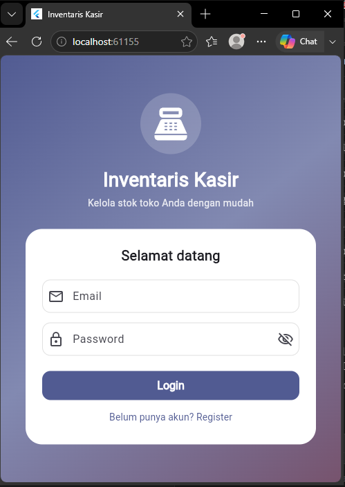
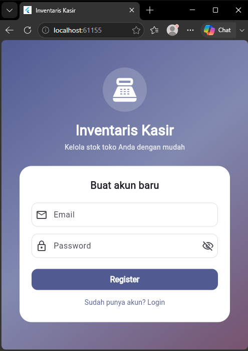
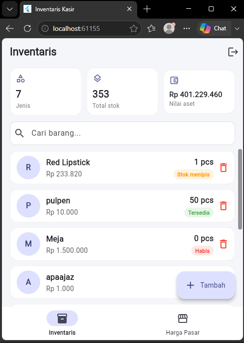
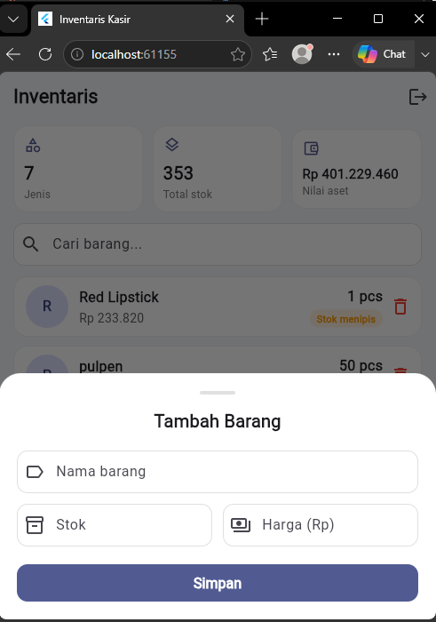
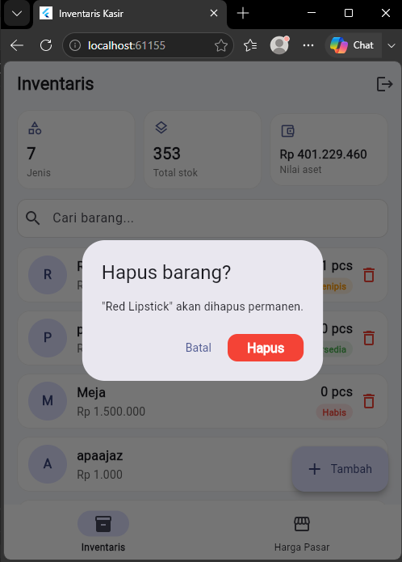
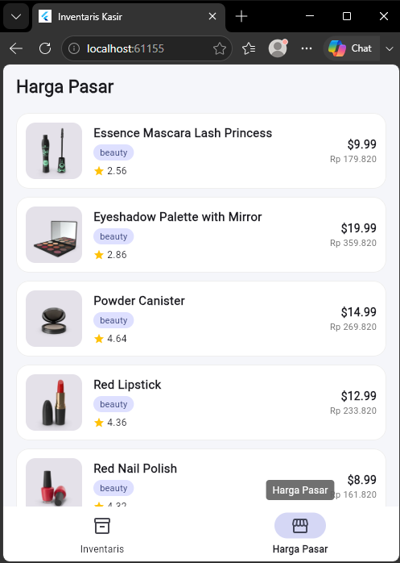
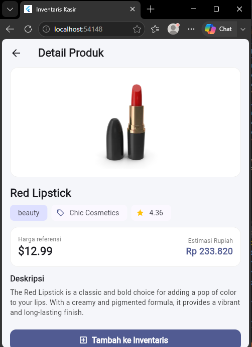

# Inventaris Kasir

Aplikasi Flutter untuk mengelola inventaris barang toko/warung (mini iPOS). Data barang disimpan di **Cloud Firestore**, login memakai **Firebase Auth**, state management memakai **Provider**, dan harga pasar referensi diambil dari **DummyJSON** lewat **Dio**.

> UTS Pemrograman Multi Platform Lanjutan, Semester Ganjil 2026/2027, Kelompok **TA5J**
> Dosen: Rezky Yuranda, M.Kom | Tema: **Inventaris Kasir** (collection `items`)

---

## Anggota Kelompok

| NIM | Nama | Peran |
|---|---|---|
| 2411500082 | Peter Antonius Lie | Anggota 1: Auth + navigasi + struktur folder |
| 2411500064 | Najma Albasyar| Anggota 2: Firestore CRUD + Model/Service/Provider + ViewState |
| 2411500076 | Ridho Ilham | Anggota 3: Dio REST API + loading/error/empty + Future vs Stream |
| 2411500084 | Taufiq Sadawi| Anggota 4: UI Home CRUD (tampilan, form, pencarian) + dokumentasi + pengujian |


---

## Fitur Aplikasi

**Firebase Auth**
- Register, Login, dan Logout dengan email dan password.
- Auth state listener memakai `Stream<User?>` (`authStateChanges()`).

**Firestore CRUD (collection `items`)**
- Tambah, lihat (realtime), ubah, dan hapus barang.
- Struktur data: `{name, stock, price, createdAt (Timestamp), uid}`.
- Menggunakan `CollectionReference` dan `snapshots()` (Stream) serta `get()` (Future).
- Pencarian dan pengurutan dilakukan di sisi client (Dart), **tanpa `orderBy`** pada query Firestore.
- Kartu ringkasan (jenis barang, total stok, nilai aset) dan badge status stok (Tersedia, Stok menipis, Habis).

**REST API dengan Dio (DummyJSON products)**
- Halaman Harga Pasar (List API) dan Detail produk, read-only.
- Loading spinner, snackbar error dengan tombol "Coba lagi", tombol Retry, dan empty state.
- Harga dolar dikonversi ke estimasi rupiah, dan produk bisa ditambahkan ke inventaris.

**State management (Provider)**
- 3 `ChangeNotifier` di dalam `MultiProvider` pada `main.dart`: `AuthProvider`, `ItemProvider`, `ApiProvider`.
- Pola `ViewState`: `loading`, `loaded`, `error`, `empty`.
- `notifyListeners()` dipakai di semua provider, dan subscription di-`cancel()` pada `dispose()`.

**Navigasi (4 layar)**
1. Login/Register
2. Home CRUD (tab Inventaris)
3. List API (tab Harga Pasar)
4. Detail API

---

## Screenshot

| Login | Register |
|---|---|
|  |  |

| Home |
|---|
|  |

| Form tambah barang | Hapus barang |
|---|---|
|  |  |

| List API (Harga Pasar) | Detail API |
|---|---|
|  |  |


---

## Struktur Folder

```
lib/
├─ main.dart                      # Firebase init, MultiProvider, AuthGate, navbar
├─ firebase_options.dart          # hasil flutterfire configure (WAJIB di-commit)
├─ models/
│  ├─ item_model.dart             # model barang + field Timestamp
│  └─ product_model.dart          # model produk DummyJSON
├─ services/
│  ├─ firestore_service.dart      # CRUD Firestore (CollectionReference)
│  └─ api_service.dart            # pemanggilan Dio
├─ providers/
│  ├─ view_state.dart             # enum loading, loaded, error, empty
│  ├─ auth_provider.dart          # AuthProvider
│  ├─ item_provider.dart          # provider Firestore
│  └─ api_provider.dart           # provider Dio
└─ screens/
   ├─ login_screen.dart
   ├─ home_screen.dart
   ├─ api_list_screen.dart
   └─ api_detail_screen.dart
```

---

## Cara Menjalankan Aplikasi

### Prasyarat
- Flutter SDK (cek dengan `flutter doctor`)
- Node.js dan npm
- Git
- Emulator Android atau perangkat fisik (USB debugging aktif)
- Akun Google untuk Firebase

### Langkah

1. **Clone repository**
   ```bash
   git clone https://github.com/Peter-oxy/iventaris_kasir.git
   cd iventaris_kasir
   ```

2. **Pasang dependensi**
   ```bash
   flutter pub get
   ```

3. **Siapkan Firebase dengan `flutterfire configure`**

   File `lib/firebase_options.dart` dan `android/app/google-services.json` sudah disertakan di repo (terhubung ke project Firebase kelompok), jadi aplikasi sudah bisa langsung dijalankan pada langkah 5.

   Jika ingin memakai **project Firebase sendiri**:
   ```bash
   npm install -g firebase-tools
   dart pub global activate flutterfire_cli
   firebase login
   flutterfire configure
   ```
   - Pilih project Firebase Anda (atau buat baru).
   - Pilih platform **android** (cukup untuk pengujian).
   - Jika ditanya untuk menimpa `firebase_options.dart`, jawab **yes**.

4. **Aktifkan layanan di Firebase Console** (hanya jika memakai project sendiri)
   - **Authentication** → Sign-in method → aktifkan **Email/Password**.
   - **Firestore Database** → Create database.
   - Tab **Rules**, tempel aturan berikut lalu **Publish**:
    

5. **Jalankan aplikasi**
   ```bash
   flutter run
   ```
   Daftar akun baru lewat tombol **Register**, lalu login.

### Catatan
- Data barang difilter per akun (`where('uid', isEqualTo: uid)`), sehingga tiap akun hanya melihat barangnya sendiri.
- Query Firestore **tidak memakai `orderBy`**. Pengurutan dilakukan di Dart (`ItemProvider`) sehingga tidak membutuhkan index Firestore.
- Halaman Harga Pasar membutuhkan koneksi internet (API publik `https://dummyjson.com`).
- Jika build Android gagal karena `minSdk`, ubah `minSdk = 23` di `android/app/build.gradle.kts`, lalu jalankan `flutter clean` dan `flutter run`.

---

## Future vs Stream (ringkasan)

| | Future | Stream |
|---|---|---|
| Hasil | Satu nilai di masa depan | Banyak nilai berturut-turut |
| Contoh di project | `Dio.get()`, `Firestore.get()` | `snapshots()`, `authStateChanges()` |
| Cara dipakai | `await` | `.listen()` |
| Dispose | Tidak perlu | Wajib `cancel()` |

---

## Link Video

Video penjelasan (Google Drive): **([link video](https://drive.google.com/drive/folders/1YKggMbH377PljGYQvm271Ga-BRs5Js5j?usp=drive_link))**

---

---

## Link Github

**([link github](https://github.com/Peter-oxy/iventaris_kasir.git))**

---
